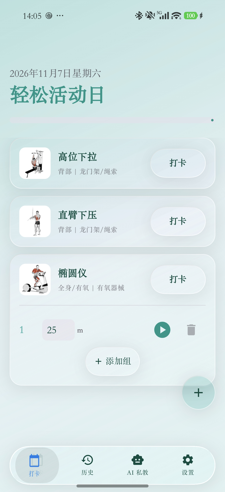

# Gymnota 6.2

Gymnota is an Android workout tracker built with Kotlin and Jetpack Compose. It supports weekly routines, daily workout logs, body measurements, history charts and an AI coach.

[简体中文](README.md) · [6.2 release notes, Chinese](RELEASE_NOTES_6.2.md)

  

## New in 6.2

### Offline exercise catalogue and animations

- Bundle 1,324 exercises and their 180×180 GIF animations for offline browsing.
- Switch between My exercises and Exercise catalogue within the management page using the glass tab slider. The personal library retains Strength, Cardio and Core categories.
- Filter by body part and search translated names, original English names, exercise IDs or instructions.
- Preview an exercise, then confirm its training category, logging type, unilateral setting and target before adding it to the personal library.
- Associate supported existing exercise names with animations while preserving personal names. Animations can also be selected manually in the editor.
- Store custom photo and animation references separately. Remove a custom photo while retaining the associated animation.

### Names and interface in five languages

The interface supports Simplified Chinese, English, Spanish, German and Japanese. The catalogue includes Chinese, Spanish, German and Japanese exercise names alongside the original English names.

These names use the translation draft reviewed during this update. Uncommon terms and variants remain open to correction. Instructions use available translations for the selected language, with English fallback for German and Japanese.

### Liquid Glass interface

- Apply shared glass controls to workout completion, Add set and Add exercise.
- Unify the history exercise selector, list/chart tabs, left/right selection and daily/monthly chart controls.
- Unify weekly routine and exercise-library entries, language selection and settings switches.
- Reduce white overlays and adapt materials to the selected light or dark theme. The bottom navigation samples page content, while list cards use lighter effects.
- Show static first frames in list thumbnails and keep GIF playback in detail views.
- Adjust duplicated tab-label rendering, gesture-cancellation cleanup and indicator positioning to address overlapping text and lingering deformation.
- Fix the management Add button overlapping the root navigation and remove the old outline from the focused history selector.

## Features

- **Workout logging**. Weekly routines, templates, daily tasks, sets and completion tracking. Supports weight × reps, duration, reps-only and unilateral records.
- **Exercise management**. Personal exercises, a bundled catalogue, instructions, custom photos and demonstration animations.
- **History and charts**. Training heatmaps, body measurements, cardio duration, maximum recorded exercise weight and separate left/right charts for unilateral exercises.
- **Body measurements**. Weight, fat mass, skeletal muscle mass, body water, waist and hip measurements, plus profile-based BMI and BMR.
- **Timer**. Preparation time, final countdown, sound effects and notification countdown.
- **AI coach**. Weekly plan suggestions, chat, image analysis, chat history and long-term memory summaries. Convert advice into a weekly-plan CSV for import.
- **Data management**. Export training history as CSV, import weekly routines and back up or restore the personal database.

## Getting started

### Add an exercise from the catalogue

1. Open exercise management from Settings.
2. Switch to Exercise catalogue and search or filter by body part.
3. Open the exercise details and choose Use exercise.
4. Confirm its name, category, logging type, unilateral setting and target, then save.

Personal exercise names are retained. Automatic animation lookup applies to supported name mappings. Other exercises can be assigned an animation manually.

### Photos and animations

Open an exercise for editing to take a photo, select a gallery image or choose a bundled animation. Remove photo appears when a custom photo is attached. The change takes effect after saving. Photo and animation references are stored independently.

### Workouts and history

Add exercises to the daily plan, enter set data and mark tasks complete. In History, switch between list and charts, choose an exercise and adjust side or daily/monthly granularity where applicable.

### AI coach

Configure the provider, API key, model and base URL in Settings or the AI page. Generate weekly-plan advice, chat or analyze an image, then convert a plan into CSV for import.

API configuration and training records are stored in the local database. AI features send the relevant context and submitted images to the configured model service.

## Backups and upgrades

Personal data uses Room schema **v19**, with an existing migration chain for older versions. Version 19 adds a separate animation reference and migrates bundled-animation references previously stored in the photo field.

The bundled catalogue is a separate SQLite database, extracted to the app's no-backup directory on first use. The catalogue and packaged media are excluded from personal database backups and supplied by the APK after restoration.

## Weekly routine CSV

~~~csv
Day,Name,Category,Target,BodyPart,Equipment,IsUnilateral,LogType
1,Seated Chest Press,STRENGTH,3x12,part_chest,equip_machine,false,0
1,Plank,CORE,3x60s,part_abs,equip_bodyweight,false,1
2,Barbell Squat,STRENGTH,4x10,part_thighs,equip_barbell,false,0
3,Running,CARDIO,30min,part_cardio,equip_cardio_machine,false,1
4,Crunches,CORE,4x20,part_abs,equip_bodyweight,false,2
~~~

- Day is 1–7, Monday to Sunday.
- Category is STRENGTH, CARDIO or CORE.
- Target is the default workout prescription, such as 3x12, 30min or 3x60s.
- IsUnilateral is true or false.
- LogType is 0 for weight × reps, 1 for duration or 2 for reps-only.
- Body-part keys include part_chest, part_back, part_shoulders, part_arms, part_abs, part_hips, part_thighs, part_calves, part_cardio and part_other.
- Common equipment keys include equip_barbell, equip_dumbbell, equip_machine, equip_cable, equip_smith_machine, equip_bodyweight, equip_cardio_machine and equip_other.

Import replaces routine entries for the weekdays included in the CSV. Review the days and exercise contents before importing.

## Technology

| Area | Implementation |
|---|---|
| Language and UI | Kotlin, Jetpack Compose, Material 3 |
| State and concurrency | ViewModel, Coroutines, Flow |
| Personal data | Room 2.8.4, schema v19 |
| Bundled catalogue | Separate SQLite, compressed assets, no-backup directory |
| Images and animations | Coil with GIF decoding |
| Network | Retrofit, OkHttp |
| Charts | Compose Canvas |
| Glass effects | Kyant0 Backdrop |
| Android | Minimum API 26, target API 35, compile API 36 |

## Resources and credits

The catalogue is adapted from [hasaneyldrm/exercises-dataset](https://github.com/hasaneyldrm/exercises-dataset), with source attribution retained.

**© Gym visual — [gymvisual.com](https://gymvisual.com/)**

The upstream MIT license covers code, data structure and instruction text. Exercise media has separate terms. The packaged [LICENSE](app/src/main/assets/catalog/LICENSE.txt) and [NOTICE](app/src/main/assets/catalog/NOTICE.md) retain the relevant distinctions and attribution.

Glass effects use [Kyant0/AndroidLiquidGlass](https://github.com/Kyant0/AndroidLiquidGlass). Design and implementation comparisons also referenced [QWEA0/Liquid-Glass-Android](https://github.com/QWEA0/Liquid-Glass-Android).

## Version

- Release series **6.2**, application version **6.2.0**.
- Version code **6200**.
- Designed & Built by enersto & Hajimi.
