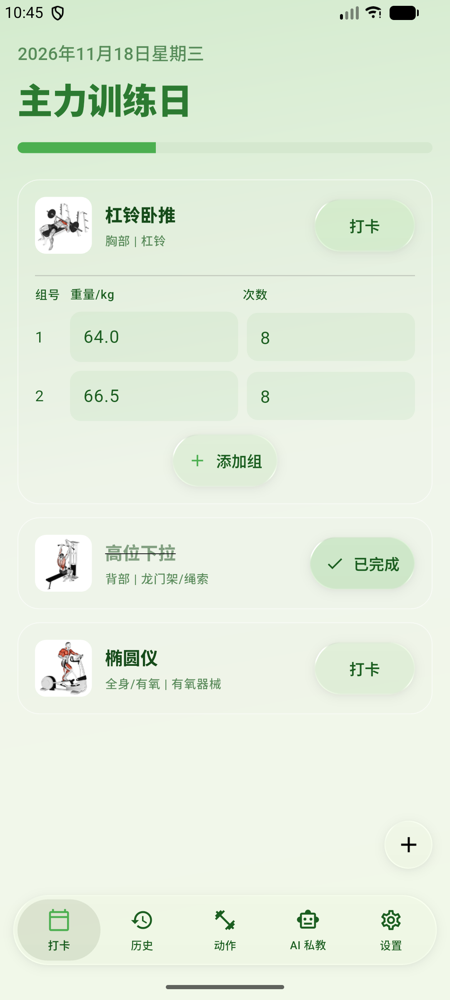
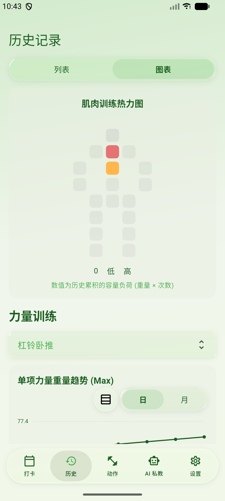
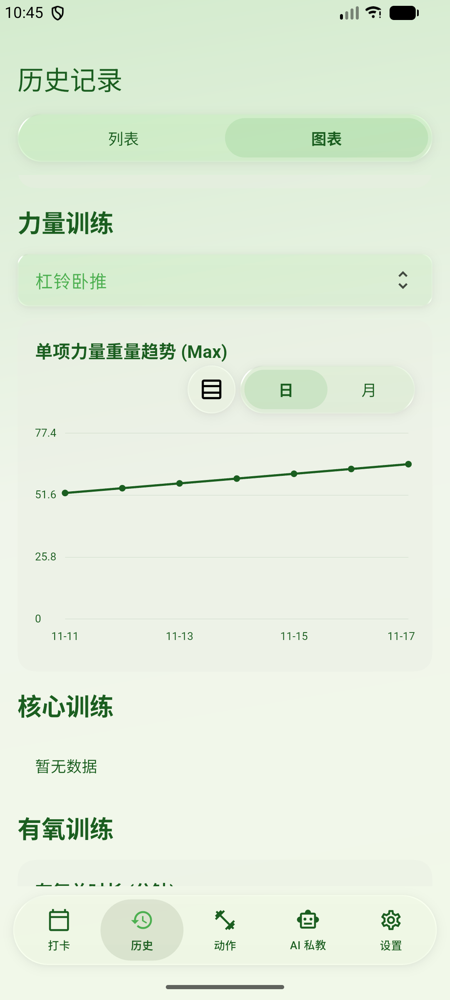
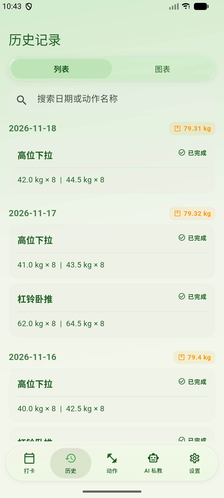
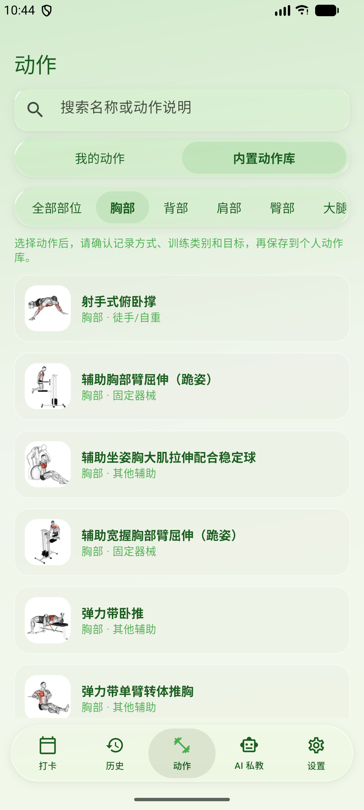
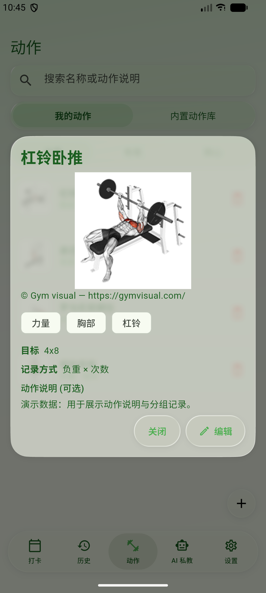
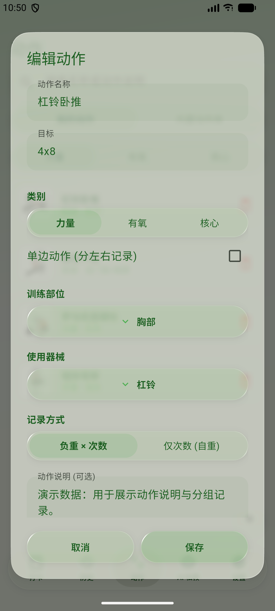
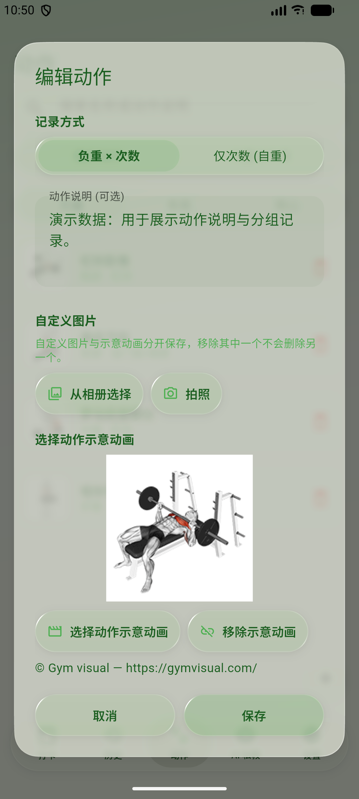
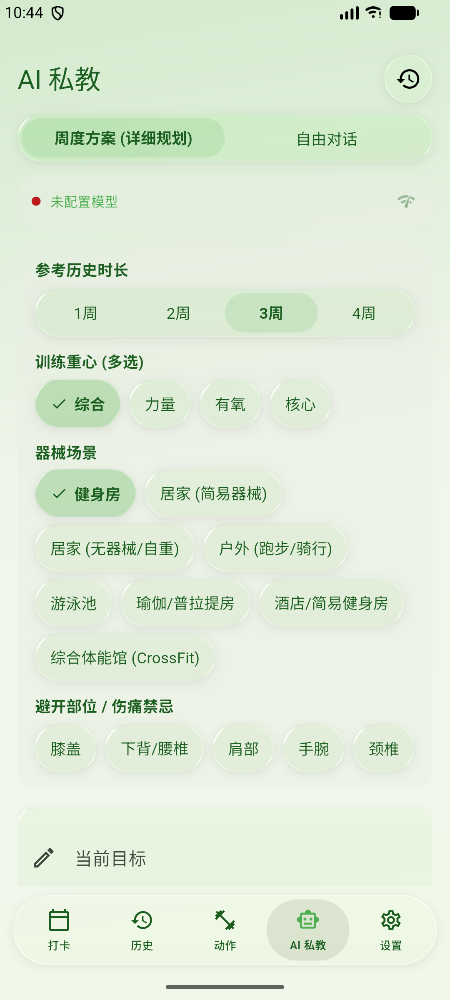
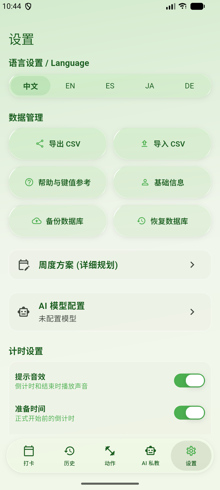

# Gymnota 6.4

An Android workout journal for weekly routines, daily training, body measurements and progress charts, with an optional AI coach connected to your own model provider.

The default interface uses **Flutter**. **Rust** owns the main database queries, transactions, migrations, history calculations and timer transitions. Android adapters retain notifications, camera/gallery access, document selection and network transport.

[简体中文](README.md) · [6.4 changes](RELEASE_NOTES_6.4.md) · [6.2 history](RELEASE_NOTES_6.2.md)

> Screenshots show the current app in Chinese with demonstration data, not personal backups or API credentials.

## Daily workouts

- Configure training, active recovery, light activity and rest days; apply the day's weekly routine.
- Add exercises and sets, logging weight × reps, reps only or duration. Track left and right sides separately.
- Use preparation, pause/resume, final countdown, sounds and background timer notifications. Finished sets update history.
- Swipe to reveal Delete, then continue swiping or tap the trash button to confirm.
- Record weight and optional body measurements during the workout flow.

<p align="center"></p>

## History and charts

History opens on charts by default, with a searchable records list and selectable text available alongside it.

- Training heatmap, strength/core exercise trends, cardio duration, weight and body measurements.
- Exercise selection, left/right views for unilateral records, and daily/monthly views.
- BMI, BMR and waist-to-hip ratio calculated using the profile and recorded measurements, preserving the existing chart semantics.
- Already-open pages refresh after workout, measurement and settings changes.

<p align="center">
  
  
  
</p>

## Exercises and offline animations

Exercises has its own bottom tab, with My exercises and the bundled catalogue.

- **1,324 exercises and lossless animated WebP assets**, bundled offline at **180×180**.
- Filter by body part; search translated/original names, IDs and instructions.
- Preview animations and instructions, then open the editor. Existing matched personal exercises retain their own names and targets.
- Chinese, English, Spanish, German and Japanese interfaces. The catalogue retains 12 upstream language resources, with English fallback for unavailable instructions.

<p align="center">
  
  
</p>

Animation attribution: **© Gym visual — https://gymvisual.com/**. The screenshot captures one animation frame.

### Flutter exercise editor

Creating, editing and importing catalogue exercises use the same Flutter glass form, saved through Rust template transactions.

- Name, target, category, body part, equipment, logging type, unilateral setting and instructions.
- Pick a gallery photo or take one with the camera. Photos and demonstration animations have separate references and removal controls.
- Changing the animation preserves the other fields. Cancelling leaves the saved exercise unchanged.
- Saving refreshes the personal library and linked workout display.

<p align="center">
  </p>

## AI coach

- Request weekly advice using goals, history range, training focus, equipment and injury-avoidance selections.
- Free chat supports text and images where supported by the configured model.
- Compatible providers can stream answers and separately expose their public reasoning/summary fields.
- Markdown headings, lists, quotations and code blocks, with text selection and copying.
- View/delete saved advice and turn recommendations into a CSV routine for import.
- The model status strip shows configuration/connection status and links to model settings.

<p align="center"></p>

Configure your provider, API key, model and Base URL before use. Records are stored locally; AI requests send the relevant context and selected images to the provider you configure.

## Settings, routines and data

- Five interface languages, themes, day types and detailed weekly routines.
- Profile, timer preparation/countdown/audio, model and AI history-context settings.
- Weekly CSV import, training-history CSV export, field help and key references.
- Personal SQLite backup and restore. Restore migrates and validates a staged copy before replacement and restart.

<p align="center"></p>

Personal data keeps the **v19** schema, with migrations covering v7–v19. The catalogue and animations are supplied by the APK and excluded from personal backups. Original custom-photo files are not transferred across devices by a SQLite-only backup. Backups can contain AI configuration and should be handled as personal data.

## Changes since 6.2

| 6.2 | 6.4 |
|---|---|
| Kotlin/Compose root and main screens | Flutter root and five main pages with shared Liquid Glass styling |
| Exercise management under Settings | Dedicated Exercises tab with swipe/tap navigation |
| Native exercise-editing dialog | Full Flutter editor, Rust persistence and Android camera/gallery adapters |
| Bundled GIF animations | Lossless WebP; archived GIFs excluded from release assets; legacy URIs still resolve |
| Room owns main personal-data access | Rust initialization, migrations, queries, transactions and commit-driven refresh |
| Native timer/history calculations | Rust timer transitions and history calculations; Android clock/audio/notifications |
| Native AI page | Flutter coach, saved advice, Markdown and streaming display |
| Old screens reachable in the app | Old workout/editor source archived outside compilation and APK packaging |

Also includes shared title emphasis and theme colors, primary/secondary glass navigation, selection feedback, haptics and long-label layouts. Fixes cover keyboard overflow, an obscured exercise Add button, and stale lists after deleting saved advice.

Media/database deduplication and R8/resource shrinking bring an optimized ARM64 build to roughly **124 MiB**. Debug builds include development runtimes, and universal packages can contain multiple CPU architectures; their sizes are not directly comparable. See [size measurements](docs/apk-size-trimming.md).

**Room remains temporarily** for staged restore validation and compatibility code; it has not been completely removed from build dependencies. [Runtime boundaries](docs/rust-runtime.md) · [Archived sources](legacy/README.md)

## Weekly CSV

```csv
Day,Name,Category,Target,BodyPart,Equipment,IsUnilateral,LogType
1,Barbell bench press,STRENGTH,4x8,part_chest,equip_barbell,false,0
1,Plank,CORE,3x60s,part_abs,equip_bodyweight,false,1
2,Lat pulldown,STRENGTH,3x12,part_back,equip_cable,false,0
3,Elliptical,CARDIO,25min,part_cardio,equip_cardio_machine,false,1
```

Day is 1–7 (Monday–Sunday); Category is STRENGTH/CARDIO/CORE; LogType is 0 (weight × reps), 1 (duration) or 2 (reps only). Import replaces routine entries for the weekdays included in the CSV. Full keys are available in the in-app reference.

## Build and installation

Minimum Android **9 / API 28**. App version **6.4.0**, Version Code **6400**. Use a Flutter/Dart SDK matching `flutter_library/pubspec.yaml`, the Rust Android target and Android SDK/NDK. The local validated environment uses JDK 21 and NDK 28.2.13676358.

```powershell
cd flutter_library
flutter pub get
cd ..
.\gradlew.bat :app:assemblePreview -PpreviewAbi=arm64-v8a -Ptarget-platform=android-arm64
```

Output: `app/build/outputs/apk/preview/app-preview.apk`. Select the app's **preview** variant in Android Studio for the optimized test build, signed with the debug key. A production release needs your own release signing configuration. Choose the corresponding ABI for non-ARM64 devices. Debug is for development, not release-size measurement.

## Credits

- Dataset: [hasaneyldrm/exercises-dataset](https://github.com/hasaneyldrm/exercises-dataset).
- Exercise media: **© Gym visual — https://gymvisual.com/**. See the bundled [LICENSE](app/src/main/assets/catalog/LICENSE.txt), [NOTICE](app/src/main/assets/catalog/NOTICE.md) and the rights holder's terms.
- Flutter glass: [sdegenaar/liquid_glass_widgets](https://github.com/sdegenaar/liquid_glass_widgets). Native/design references: [Kyant0/AndroidLiquidGlass](https://github.com/Kyant0/AndroidLiquidGlass) and [QWEA0/Liquid-Glass-Android](https://github.com/QWEA0/Liquid-Glass-Android).

Designed & Built by enersto & Hajimi.
