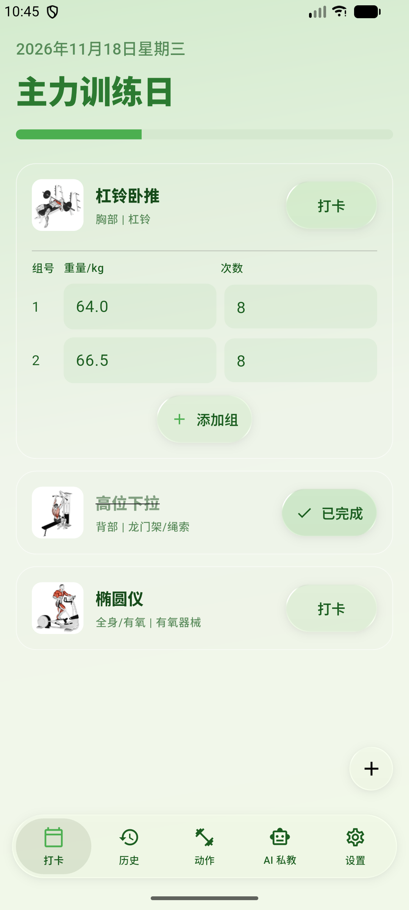
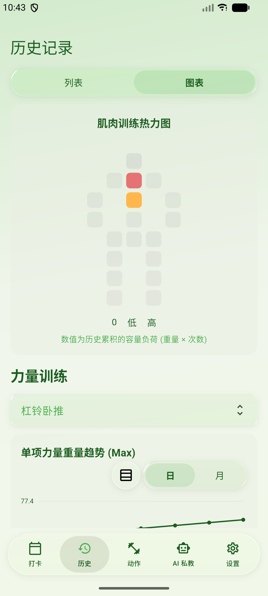
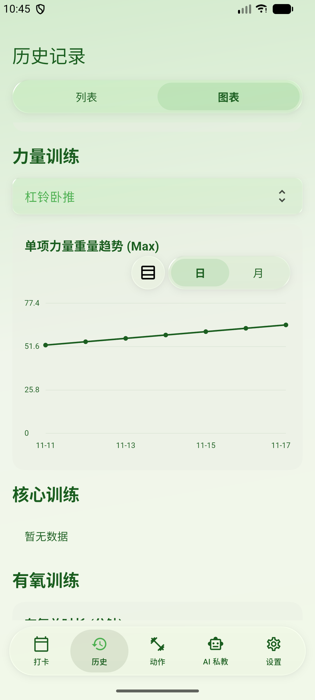
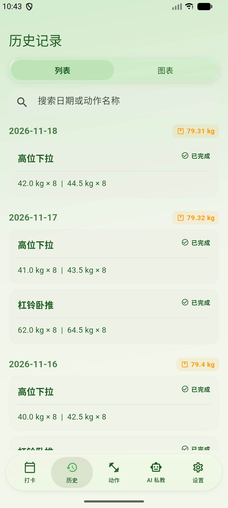
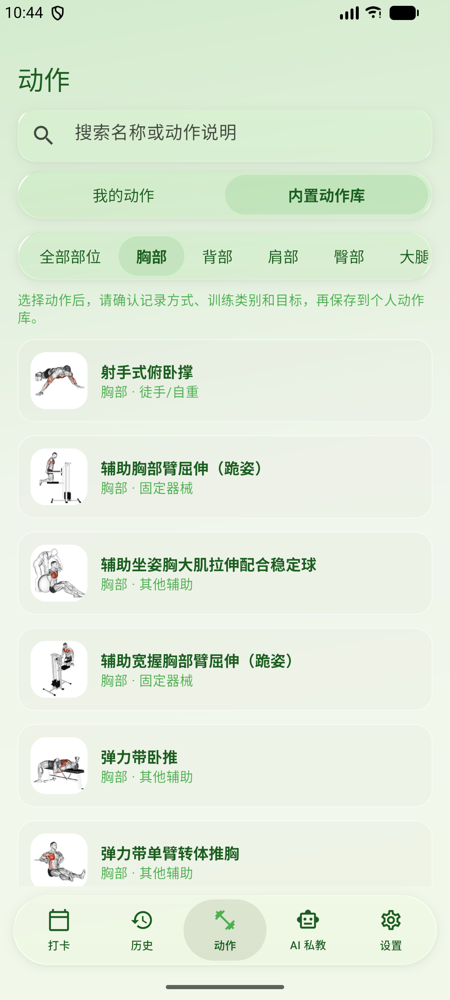
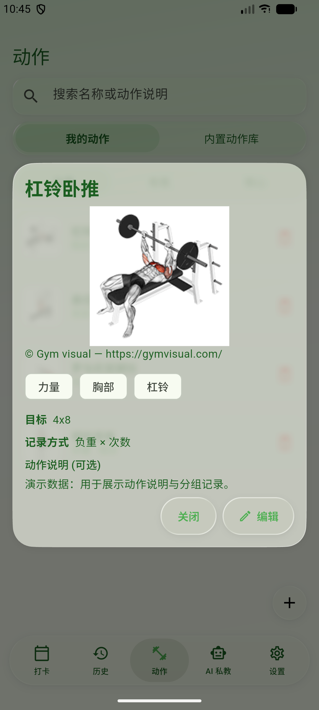
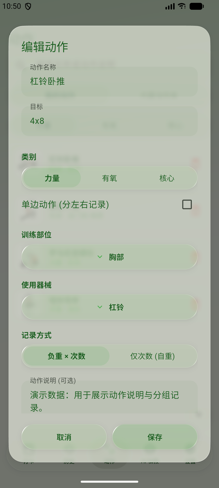
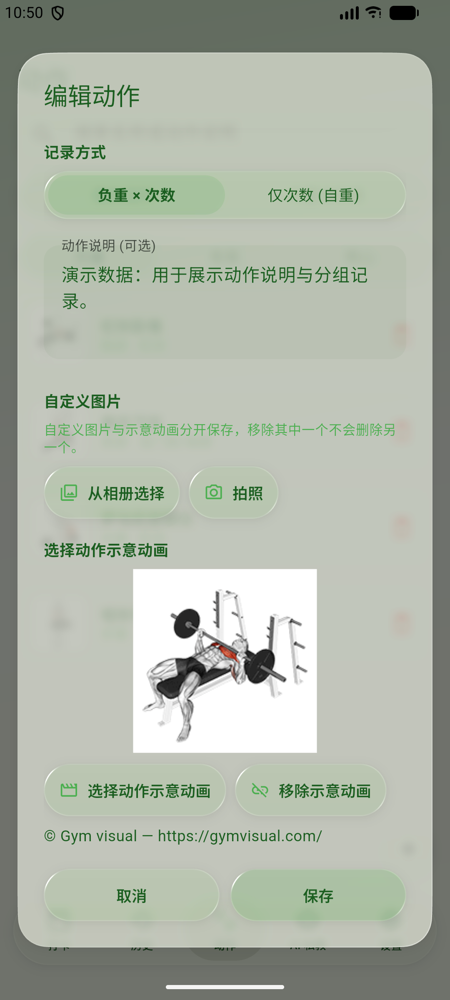
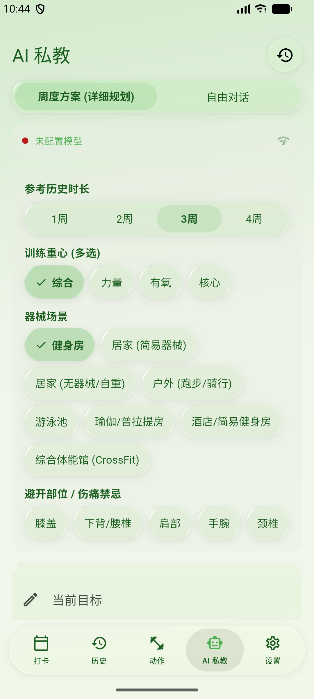
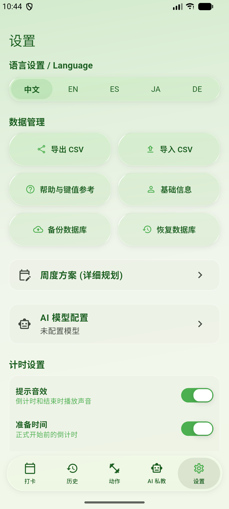

# 健身记 Gymnota 6.4

一个以本地记录为核心的 Android 健身应用：安排周计划、记录每日训练与身体指标、查看历史趋势，并按需连接自己的 AI 模型服务。

6.4 的默认界面采用 **Flutter**，个人与内置数据库的主要读写、统计和计时状态由 **Rust** 承担。Android 平台桥保留通知、相册、相机、文件选择和网络等系统接入。

[English](READEME-en.md) · [6.4 更新清单](RELEASE_NOTES_6.4.md) · [6.2 历史记录](RELEASE_NOTES_6.2.md)

> 以下截图来自当前版本的模拟器，使用演示训练数据；不会展示个人备份或 API 密钥。

## 每日打卡

- 按周类型安排主力训练、主动恢复、轻松活动或休息日，可应用当天的周度方案。
- 添加动作、增减训练组，记录重量 × 次数、仅次数或时长；单边动作分别记录左右侧。
- 计时支持准备阶段、暂停恢复、最后倒数、提示音和后台通知。完成后写入记录，历史页随之刷新。
- 左滑先露出删除操作，再继续滑动或点击垃圾桶确认删除。
- 记录体重及可选身体指标，不需要离开当前训练流程。

<p align="center"></p>

## 历史与图表

进入历史页默认显示图表，可切换到可搜索、可选择复制文本的记录列表。

- 训练热力图、力量与核心动作趋势、有氧时长、体重和身体指标。
- 按动作选择数据，查看单边记录的左右侧，并在日、月视图间切换。
- 身体指标结合档案计算 BMI、BMR 和腰臀比；保留原有记录与图表计算口径。
- 打卡、身体指标和设置变化后更新已打开的页面，无需重新进入应用。

<p align="center">
  
  
  
</p>

## 动作与离线示意动画

“动作”是独立的底部标签页，包含“我的动作”和“内置动作库”。

- 随 APK 提供 **1,324 个动作与无损动画 WebP**，无需联网下载；分辨率保持 **180×180**。
- 支持按部位筛选，以译名、英文原名、编号或说明搜索，查看动画和动作说明。
- 从内置库带入编辑；已有匹配的个人动作优先保留个人名称和目标。
- 界面支持中文、英语、西班牙语、德语和日语。内置库保留上游 12 种语言资源，说明缺译时回退英语。

<p align="center">
  
  
</p>

示意动画署名：**© Gym visual — https://gymvisual.com/**。截图展示的是动画播放中的一帧。

### Flutter 动作编辑

新增动作、编辑个人动作和内置动作导入使用同一套 Flutter 玻璃表单，保存接入 Rust 模板事务。

- 名称、默认目标、类别、部位、器械、记录方式、单边设置和说明。
- 相册选图或拍照；自定义图片与示意动画分别关联，可以单独移除。
- 选择另一段示意动画时保留其他编辑内容；取消编辑不改动已保存的动作。
- 保存后立即更新个人动作列表，可从打卡详情查看关联动作。

<p align="center">
  </p>

## AI 私教

- 根据目标、参考历史时长、训练偏好、器械场景和伤痛规避项获取周度建议。
- 自由对话支持文字和图片；具体图片能力取决于配置的模型服务。
- 兼容服务可流式显示回答；服务明确返回的公开思考摘要或推理字段单独展示。
- 支持标题、列表、引用、代码块等 Markdown 样式与文本选择复制。
- 查看、删除历史建议，将建议整理为 CSV 周计划并导入。
- 模型状态条显示配置和连接状态，可直接进入模型配置。

<p align="center"></p>

使用前需在设置中配置服务商、API Key、模型和 Base URL。训练数据保存在本地；使用 AI 功能时，相关上下文及主动选择的图片会发送给你配置的服务。

## 设置、周计划与数据管理

- 五语言切换、主题选择、周类型及详细周度方案。
- 基础档案、计时准备/倒数/声音设置、AI 模型与历史上下文设置。
- 导入周计划 CSV、导出训练历史 CSV，查看字段帮助和键值参考。
- 导出和恢复个人 SQLite 备份；恢复前先在临时副本上迁移、校验，成功后重启加载。

<p align="center"></p>

个人数据库沿用 **v19** 表结构，迁移链覆盖 v7–v19。内置动作库和动画由 APK 提供，不进入个人备份；个人照片原文件不随单个 SQLite 备份跨设备转移。备份可能包含 AI 配置，应按个人数据妥善保管。

## 自 6.2 以来的变化

| 6.2 | 6.4 |
|---|---|
| Kotlin/Compose 根导航与主要页面 | Flutter 默认根导航和五个主页面，统一 Liquid Glass 风格 |
| 动作管理位于设置中 | 独立“动作”标签页，分类导航支持滑动和点选 |
| 动作编辑通过原生弹窗 | Flutter 完整编辑表单，Rust 保存；相册/相机保留系统桥接 |
| GIF 动画随包 | 无损 WebP；发布包排除原 GIF 存档，旧 GIF URI 自动兼容 |
| Room 负责个人库主要读写 | Rust 负责初始化、迁移、事务、查询及提交后的刷新通知 |
| 原生训练计时与历史计算 | Rust 计时状态和历史计算，Android 执行时钟、通知与音效 |
| 原生 AI 页面 | Flutter AI 界面、历史建议、Markdown 与流式展示 |
| 旧页面在应用中可进入 | 旧打卡和动作编辑源码独立存档，不进入编译与打包 |

还包括：统一标题与主题字体颜色、一级/二级玻璃导航、选中状态、触感反馈和多语言长文本布局；修复输入时底部溢出、动作管理新增按钮遮挡、删除建议后列表不刷新等问题。

发布体积通过媒体去重、动作库去重、R8 和资源裁剪缩减。ARM64 优化构建约 **124 MiB**；debug 包包含调试运行库，通用包还可能包含多种 CPU 架构，不能与该数字直接比较。详见 [体积裁剪与实测](docs/apk-size-trimming.md)。

**Room 暂时保留**用于恢复时的临时副本结构校验及兼容代码，尚未从构建依赖中完全移除。[运行链路](docs/rust-runtime.md) · [旧源码存档](legacy/README.md)

## 周计划 CSV

```csv
Day,Name,Category,Target,BodyPart,Equipment,IsUnilateral,LogType
1,杠铃卧推,STRENGTH,4x8,part_chest,equip_barbell,false,0
1,平板支撑,CORE,3x60s,part_abs,equip_bodyweight,false,1
2,高位下拉,STRENGTH,3x12,part_back,equip_cable,false,0
3,椭圆仪,CARDIO,25min,part_cardio,equip_cardio_machine,false,1
```

`Day` 为 1–7（周一至周日）；`Category` 为 STRENGTH / CARDIO / CORE；`LogType` 为 0（重量×次数）、1（计时）、2（仅次数）。导入替换 CSV 涉及星期的周计划条目，完整键值可在应用帮助中查看。

## 构建与安装

最低 Android **9 / API 28**；当前应用版本 **6.4.0**，Version Code **6400**。需要满足 `flutter_library/pubspec.yaml` 的 Flutter/Dart SDK、Rust Android 目标及 Android SDK/NDK；本地验证使用 JDK 21、NDK 28.2.13676358。

```powershell
cd flutter_library
flutter pub get
cd ..
.\gradlew.bat :app:assemblePreview -PpreviewAbi=arm64-v8a -Ptarget-platform=android-arm64
```

产物为 `app/build/outputs/apk/preview/app-preview.apk`。Android Studio 中选择 `app` 的 **preview** 变体可运行优化测试版，使用调试签名；正式 release 需要自己的发布签名。ARM64 以外的设备需选择相应架构。debug 用于开发调试，不作为发行体积基准。

## 资源与致谢

- 内置数据：[hasaneyldrm/exercises-dataset](https://github.com/hasaneyldrm/exercises-dataset)。
- 动作媒体：**© Gym visual — https://gymvisual.com/**。许可范围请查看随包 [LICENSE](app/src/main/assets/catalog/LICENSE.txt)、[NOTICE](app/src/main/assets/catalog/NOTICE.md) 及权利方条款。
- Flutter 玻璃组件：[sdegenaar/liquid_glass_widgets](https://github.com/sdegenaar/liquid_glass_widgets)。原生实现与设计对照参考 [Kyant0/AndroidLiquidGlass](https://github.com/Kyant0/AndroidLiquidGlass) 和 [QWEA0/Liquid-Glass-Android](https://github.com/QWEA0/Liquid-Glass-Android)。

Designed & Built by enersto & Hajimi.
