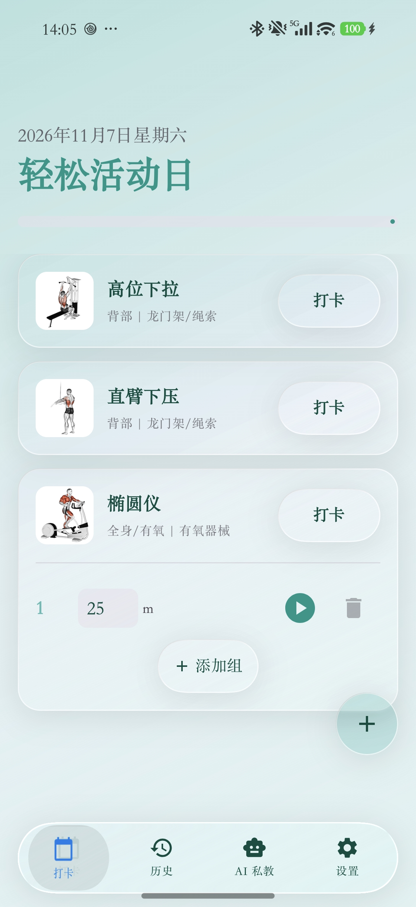

# 健身记 Gymnota 6.2

健身记是一款使用 Kotlin 与 Jetpack Compose 开发的 Android 健身记录应用，支持周度计划、每日训练打卡、身体指标记录、历史图表和 AI 私教。

[English](READEME-en.md) · [6.2 修改与新增清单](RELEASE_NOTES_6.2.md)

  

## 6.2 更新

### 离线动作库与示意动画

- 随 APK 内置 1,324 个动作及对应的 180×180 GIF，可离线浏览。
- 在管理动作库页面，通过“我的动作／内置动作”玻璃滑动栏切换两个库。个人库保留力量、有氧、核心分类。
- 支持按部位筛选，按译名、英文原名、动作编号或说明搜索。
- 选择动作后可查看动画与说明，确认训练类别、记录方式、是否单边和默认目标，再保存到个人动作库。
- 为部分既有动作建立名称映射，保留个人命名并显示对应动画。也可在动作编辑中手动选择示意动画。
- 自定义图片与示意动画使用独立关联，支持移除自定义图片。

### 五语言名称与界面

界面支持简体中文、English、Español、Deutsch、日本語。内置动作已补齐中、西、德、日语名称，支持使用译名和英文原名搜索。

名称译文采用本轮核对初稿，部分生僻名称仍可校订。动作说明按当前语言读取已有译文，德语、日语缺少译文时回退英文。

### Liquid Glass 界面

- 打卡页统一打卡、添加组和添加动作按钮。
- 历史页统一动作选择、列表／图表切换、左右侧选择和日／月切换。
- 设置页统一周度方案、动作库入口、语言选择和开关控件。
- 减少固定白色覆盖，适配深浅主题。底部导航采样页面内容，列表卡片使用较轻的效果。
- 列表缩略图显示静态首帧，详情继续播放动画。
- 调整滑动栏的重复文字绘制、手势取消复位及滑块定位，处理叠影和变形残留问题。
- 修复动作管理页新增按钮被底部导航遮挡，以及历史选择框保留旧式外框的问题。

## 主要功能

- **训练记录**。周计划、动作模板、每日任务、分组记录和完成打卡。支持重量×次数、计时、仅次数三种记录方式，以及左右单边记录。
- **动作管理**。个人动作库、内置目录、动作说明、自定义图片和示意动画。
- **历史统计**。训练热力图、体重与身体指标、有氧时长、单项动作最大记录重量，以及单边动作左右侧图表。
- **身体指标**。体重、体脂肪量、骨骼肌量、体水分、腰围和臀围记录，结合档案计算 BMI、BMR 等指标。
- **训练计时**。准备时间、最后倒数、提示音效和通知栏计时。
- **AI 私教**。周计划建议、自由对话、图片分析、聊天历史和长期记忆摘要。可将建议转为 CSV 周计划再导入。
- **数据管理**。训练历史 CSV 导出、周计划 CSV 导入、个人数据库备份与恢复。

## 使用方式

### 从内置库添加动作

1. 在设置页打开“管理动作库”。
2. 切换到“内置动作”，通过搜索或部位筛选寻找动作。
3. 打开详情并选择“使用此动作”。
4. 确认名称、训练类别、记录方式、单边标记和默认目标后保存。

已有的个人动作名称会继续保留。自动关联适用于已建立映射的名称，其余动作可在编辑页手动指定动画。

### 管理图片与动画

在动作详情中进入编辑，可拍照、从相册选择图片，或选择内置示意动画。存在自定义图片时会显示“移除图片”，点击后保存生效。照片与示意动画分别保存。

### 记录训练与查看历史

在打卡页添加动作、填写每组数据并完成打卡。在历史页切换列表或图表，选择具体动作、左右侧及日／月粒度查看趋势。

### 使用 AI 私教

在设置或 AI 页面配置模型服务商、API Key、模型名与服务地址。可生成周计划建议、对话或分析图片，将计划整理成 CSV 后导入。

API 配置和训练数据保存在本地数据库。使用 AI 功能时，对应上下文及主动提交的图片会发送到配置的模型服务。

## 备份与升级

个人数据使用 Room 数据库，当前版本为 **v19**，包含从旧版本升级的迁移链。v19 将动作图片与动画关联拆为独立字段，兼容旧版本中放在图片字段里的内置动画引用。

内置目录使用独立 SQLite，首次使用时解压到应用的免备份目录。目录和随包媒体不进入个人数据库备份，恢复后由 APK 提供内置资源。

## 周计划 CSV

~~~csv
Day,Name,Category,Target,BodyPart,Equipment,IsUnilateral,LogType
1,坐姿推胸,STRENGTH,3x12,part_chest,equip_machine,false,0
1,平板支撑,CORE,3x60s,part_abs,equip_bodyweight,false,1
2,杠铃深蹲,STRENGTH,4x10,part_thighs,equip_barbell,false,0
3,有氧跑,CARDIO,30min,part_cardio,equip_cardio_machine,false,1
4,卷腹,CORE,4x20,part_abs,equip_bodyweight,false,2
~~~

- Day 使用 1–7，对应周一至周日。
- Category 使用 STRENGTH、CARDIO、CORE。
- Target 是默认训练目标，例如 3x12、30min、3x60s。
- IsUnilateral 使用 true 或 false。
- LogType 使用 0 表示重量×次数，1 表示计时，2 表示仅次数。
- 部位键包括 part_chest、part_back、part_shoulders、part_arms、part_abs、part_hips、part_thighs、part_calves、part_cardio、part_other。
- 常用器械键包括 equip_barbell、equip_dumbbell、equip_machine、equip_cable、equip_smith_machine、equip_bodyweight、equip_cardio_machine、equip_other。

导入会替换 CSV 涉及日期对应的周计划条目，请在导入前核对星期与动作内容。

## 技术栈

| 项目 | 实现 |
|---|---|
| 语言与界面 | Kotlin、Jetpack Compose、Material 3 |
| 状态与异步 | ViewModel、Coroutines、Flow |
| 个人数据 | Room 2.8.4，数据库 v19 |
| 内置目录 | 独立 SQLite、压缩 assets、免备份目录 |
| 图片与动画 | Coil、GIF 解码 |
| 网络 | Retrofit、OkHttp |
| 图表 | Compose Canvas |
| 玻璃效果 | Kyant0 Backdrop |
| Android | 最低 API 26，目标 API 35，编译 API 36 |

## 资源与致谢

内置数据来自 [hasaneyldrm/exercises-dataset](https://github.com/hasaneyldrm/exercises-dataset)，保留了数据来源和媒体署名。

**© Gym visual — [gymvisual.com](https://gymvisual.com/)**

上游 MIT 许可覆盖代码、数据结构与说明文字，媒体有独立许可条款。随包保留 [LICENSE](app/src/main/assets/catalog/LICENSE.txt) 与 [NOTICE](app/src/main/assets/catalog/NOTICE.md)，媒体使用范围以这些声明及权利方条款为准。

玻璃效果基于 [Kyant0/AndroidLiquidGlass](https://github.com/Kyant0/AndroidLiquidGlass)，实现对照参考了 [QWEA0/Liquid-Glass-Android](https://github.com/QWEA0/Liquid-Glass-Android)。

## 版本信息

- 发布系列为 **6.2**，应用版本为 **6.2.0**。
- Version Code 为 **6200**。
- Designed & Built by enersto & Hajimi。
